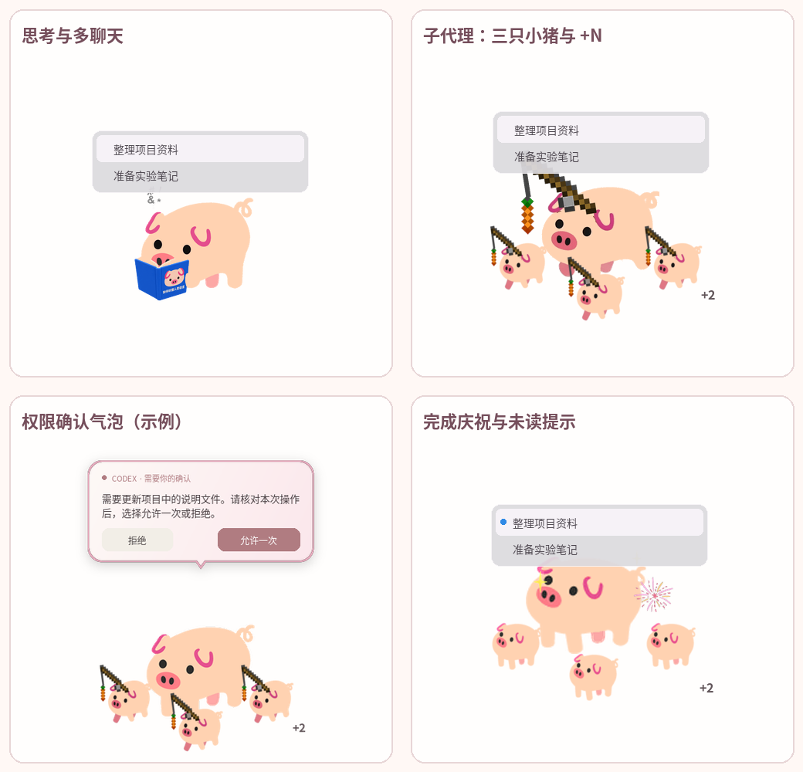

# GooglePiggy · Ubuntu / Linux

基于 [Myf-ricey/GooglePiggy_DesktopPet](https://github.com/Myf-ricey/GooglePiggy_DesktopPet)，优先保留原作动画和交互。

## 支持基线

- Ubuntu 22.04 LTS **Desktop，x86_64**。
- GNOME 的 **Ubuntu on Xorg** 会话。原生 Wayland 暂不支持；可在登录界面的齿轮菜单中选择 Xorg。
- 源码使用 Ubuntu 22.04 自带的 **Python 3.10** 创建 `.venv`，不下载其他 Python 版本。
- 便携包在原生 `ubuntu:22.04` 容器中用 Python 3.10 构建，包含运行时、Qt 和中文字体。
- Codex 联动是可选功能；未安装 Codex 时也可以使用桌宠。



## 从 Releases 安装

[下载 Linux 测试版](https://github.com/Rubbin1926/GooglePiggy_DesktopPet/releases/tag/v0.5.9-linux)，完整解压到固定目录：

```sh
mkdir -p GooglePiggy
tar -xzf GooglePiggy-0.5.9-linux-x86_64.tar.gz -C GooglePiggy
cd GooglePiggy
./install-deps-linux.sh
./start-linux.sh
```

`install-deps-linux.sh` 检查 `requirements-linux-apt.txt` 中的标准 Ubuntu 桌面库、`xdg-utils` 和中文字体，只通过 APT 安装缺少的包；普通用户需要输入 sudo 密码。
便携包本身不需要 pip 或额外的 Python 版本。

登记应用菜单入口和自启动、暂不启用 Codex 联动：

```sh
./install-linux.sh --no-hooks
```

启用 Codex 联动时，先安装 Codex，再运行 `./install-linux.sh`，在 Codex 设置 → Hooks 或 CLI `/hooks` 中审核十二项 `GooglePiggy Linux` Hook，随后新建聊天或重启客户端。
`--no-autostart` 可跳过自启动登记。程序目录需要保留；移动后重新运行安装器。

## 从源码运行

```sh
sudo apt-get update
sudo apt-get install -y git
git clone https://github.com/Rubbin1926/GooglePiggy_DesktopPet.git
cd GooglePiggy_DesktopPet
./setup-linux.sh
./start-linux.sh
```

`setup-linux.sh` 自动补齐标准运行依赖以及 `python3-venv`，用 `/usr/bin/python3` 创建 Python 3.10 虚拟环境，并安装锁定的 Python 包。
启动脚本固定使用 `.venv/bin/python`，不需要手动激活。
已有非 3.10 的 `.venv` 时，先将其移走或改名再运行安装脚本。
PySide6 / Shiboken 固定为兼容版本 6.8.3。

## 审批方式

右键小猪 → **审批方式**，设置会保存供后续启动使用。请先处理当前审批，再切换后续请求的模式。

- **小猪审批（默认）**：小猪显示“允许一次 / 拒绝”。此模式由 Hook 接管审批，Codex 不再重复弹出原生确认。
- **Codex 原生审批，小猪提示跳转**：Hook 立即交回 Codex，小猪只显示提示和“前往 Codex / 关闭提示”；允许或拒绝均在 Codex 中完成。

两种模式互斥，不会让两个窗口分别提交同一审批。

## 交互

- 待机呼吸，点击躺平；拖拽全家时播放拱动动画。
- 思考看书、工具执行追胡萝卜、压缩上下文整理物品，完成时跳跃与烟花；空闲时偷吃和睡觉。
- 每个聊天是一户家庭。鼠标移到大猪上显示任务列表，点击任务切换并打开 Codex 聊天。
- 子代理显示为最多三只小猪，多出的显示 `+N`；切换家庭保留各自动画进度。
- 拖到桌面外边缘隐藏，点击尾巴提前唤回。运行中的家庭隐藏后，等待其主任务成功且子代理结束再弹出庆祝，其他聊天的事件不会提前唤回。
- 默认权限气泡支持滚动、拒绝和允许一次；长说明需滚动至末尾才能允许。原生审批模式仅提示和跳转。没有窗口、请求过期或详情缺失时使用 Codex 原生确认。
- 右键进入休息模式、打开外观、自启动、检查更新或退出。
- 外观设置独立调整猪猪、对话框和任务栏；预览显示在实际位置，不创建任务或发送权限决定。

### 模式、动作和任务文字

菜单的勾选标记表示当前模式。“状态互动（Codex）”是默认模式：自动跟随 Codex 状态，不是播放动作的按钮；已经启用时该项变灰。休息时选择它可返回待机。

“休息模式”变灰不代表已经睡着。运行任务、等待审批、Codex 暂停、完成庆祝或其他动作尚未结束时，菜单会写明原因，避免点击后又被高优先级状态取消。空闲时选择休息，先播放约 6.4 秒入睡动画，再循环睡觉；新任务到来会自动唤醒。

默认待机是轻微呼吸，不会一直做大幅动作。没有任务时会在约 3–30 分钟内自动入睡，通常约 10 分钟，期间可能偷吃；不必等待这个计时，可以手动选择休息。睡觉时点击，有一半概率醒来，否则摆尾；唤醒动作播放两轮。重启后从状态互动模式开始。

**悬停即可显示任务列表，不需要按住左键。** 每行由“实时状态 · 聊天标题”组成。状态随本轮任务变化，标题沿用 Codex 的聊天名称，同一聊天里继续提问不会自动把标题换成最新一句话。新建聊天会出现新的一行；在 Codex 中重命名聊天，桌宠通常在 15 秒内同步。列表保留运行中的聊天和未读完成结果，不是完整历史记录。

### 功能状态一览

| 功能 | 当前行为和范围 |
| --- | --- |
| Codex 状态互动 | 思考看书、执行工具追胡萝卜、整理上下文收拾物品；暂停或等待审批时显示问号，问号动作结束后保持姿势。 |
| 完成提醒 | 跳跃和烟花；未读完成结果保留在任务列表，读取状态与 Codex 同步。 |
| 待机与休息 | 呼吸、偷吃、入睡、睡觉、Z 字和摆尾；支持手动休息、点击唤醒、新任务唤醒。 |
| 点击与拖动 | 空闲点击躺平；拖动时全家拱动，松开后恢复任务状态或待机。 |
| 多聊天 | 自动选择新任务；悬停查看状态和标题，点击一行切换并尝试打开对应 Codex 聊天。 |
| 子代理 | 同家庭显示最多三只小猪，多出的显示 `+N`；各聊天保留自己的动画进度。 |
| 贴边隐藏 | 四个桌面外边缘均可隐藏；尾巴可点击，运行家庭完成且子代理结束后自动唤回庆祝。 |
| 多显示器 | 按屏幕工作区限制位置，显示器接缝不隐藏；真实扩展屏、混合 DPI 尚未完成验收。 |
| 小猪审批 | 默认由小猪允许一次或拒绝，长说明需滚至末尾；窗口不在或无法接管时回退 Codex。 |
| Codex 原生审批 | 可切换为小猪提示和跳转，实际决定留在 Codex；不支持两个窗口同时决定同一请求。 |
| 外观 | 大小、间距、不透明度、背景和文字颜色；实际位置预览，自动保存，可恢复默认。 |
| 位置与设置 | 保存位置、外观和审批方式；休息状态不跨重启保留。 |
| 菜单与自启动 | 安装器登记应用入口、自启动；右键可关闭或开启自启动，也可完全退出。 |
| 更新与回滚 | 只检查本 Fork 的正式 Linux Release；校验下载，启动失败回滚；测试版和同版本附件替换需手动安装。 |
| 卸载 | 移除本项目入口、自启动和 Hook，保留用户状态与备份。 |
| 独立运行 | 没有 Codex 也可使用待机、点击、拖拽、休息与外观功能。 |
| 支持平台 | Ubuntu 22.04 Desktop / x86_64 / Xorg / Python 3.10；原生 Wayland 暂不支持。 |

本次最小检查覆盖模式菜单、休息禁用条件、入睡与恢复、睡眠动画推进、新任务唤醒、任务状态文字，以及上下文压缩后的结束事件和过期审批。其他功能已实现，本次未重新执行全部回归；安装与平台验证范围见 [LINUX-PORTING.md](LINUX-PORTING.md)。

Linux 使用四个外边缘，参考 macOS 行为；尾巴的可点击部分留在 GNOME 可用工作区中。
相邻显示器接缝不触发隐藏。多显示器几何测试与真实扩展屏验收分别记录。

## 状态与隐私

- 用户状态：`${XDG_STATE_HOME:-~/.local/state}/googlepiggy/`。
- 审批方式：状态目录中的 `settings.json`。
- 应用入口：`${XDG_DATA_HOME:-~/.local/share}/applications/googlepiggy-linux.desktop`。
- 自启动：`${XDG_CONFIG_HOME:-~/.config}/autostart/googlepiggy-linux.desktop`。
- Hook：`${CODEX_HOME:-~/.codex}/hooks.json`；变更前备份到状态目录的 `hook-backups/`，保留其他 Hook。
- 只读观察 Codex 本地元数据和生命周期记录，兼容已压缩的 `.jsonl.zst`；不修改 Codex 的数据库或聊天内容。
- 更新检查仅访问本 Fork 的 GitHub Releases；任务内容不用于更新请求。
- 异常记录：状态目录的 `pig-pet-error.log`；运行状态：`pig-heartbeat.json`。

`--state-dir PATH` 可隔离测试状态；`--no-observe` 禁用真实 Codex 观察，`--no-update-check` 禁用启动更新检查。

## 更新与卸载

便携发行包的“检查更新…”只识别本 Fork 的正式 `v版本-linux` 标签和对应 x86_64 包。
下载后检查 GitHub SHA-256 摘要、文件清单和平台，拒绝路径穿越、链接和特殊文件。
更新等待权限处理和拖动结束，保留旧目录备份；新进程启动检查失败时恢复旧目录并重新启动。
预发布包不会触发自动升级。源码运行通过 Git 更新，不直接替换源码目录。

卸载运行 `./uninstall-linux.sh`，移除本项目的应用入口、自启动及 Hook，保留用户状态和备份。
退出程序后可以手动移走便携目录。

## 构建与最小检查

推荐使用干净的 Ubuntu 22.04 容器构建，构建过程仅执行基础兼容性、审批与任务结束状态的针对性检查和两秒窗口启动。Docker 命令需要具有访问 Docker 服务的权限：

```sh
sudo apt-get install -y docker.io
sudo docker build --target build -f Dockerfile.linux -t googlepiggy-build .
build_container=$(sudo docker create googlepiggy-build)
mkdir -p dist
sudo docker cp "$build_container:/app/dist/." ./dist/
sudo docker rm "$build_container"
```

原生 Ubuntu 22.04 上构建时，先安装 `python3-dev binutils`，运行 `./setup-linux.sh` 后，在虚拟环境内安装 `requirements-linux-build.txt`，再运行 `./build-linux.sh`。
构建脚本不自动执行完整回归。Linux CI 为手动触发。

输出为 `dist/GooglePiggy/`、Linux 压缩包和 `SHA256SUMS.txt`。不要在正在使用的程序目录上重新构建。
上游部分文件已提交的行尾与 `.gitattributes` 不一致；开发时如出现初始行尾差异，可在本地 `.git/info/attributes` 添加 `* -text`。

程序代码遵循原仓库 [MIT License](LICENSE)，角色与动画保留 [ASSET-NOTICE.md](ASSET-NOTICE.md)。依赖许可见 [THIRD-PARTY-LINUX.md](THIRD-PARTY-LINUX.md)。
